# Beautiful Chat

A Paseo plugin that redraws the Oh My Pi (OMP) chat stream: tool calls, reasoning, prompts, approvals,
and checklists. It replaces the host rendering of OMP timeline items with typed, syntax-aware cards
that follow the active Paseo theme.

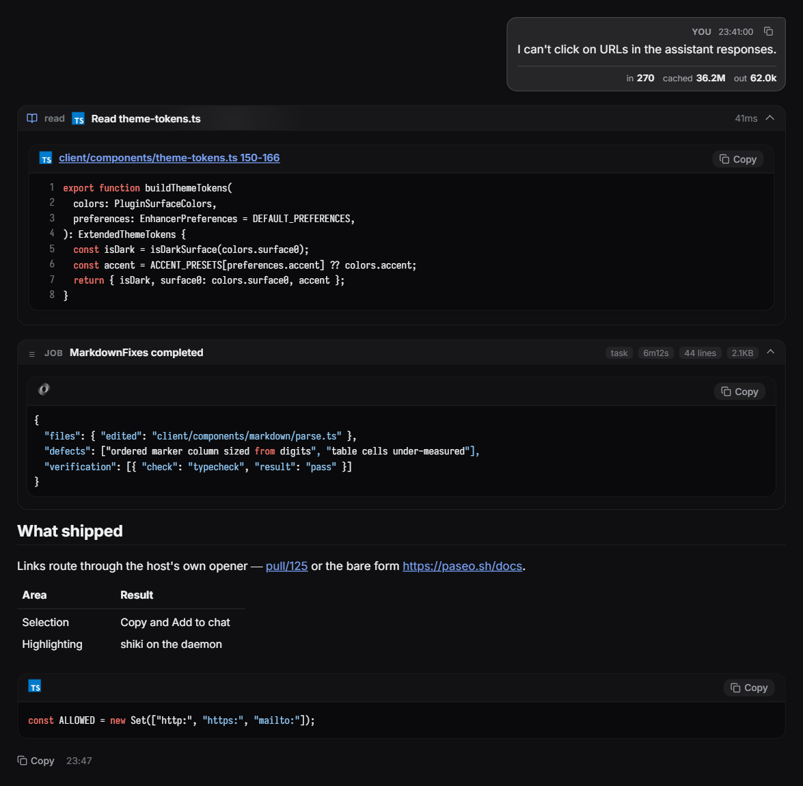

Every screenshot here is a capture of the real component, rendered by the harness in `.showcase/`.
[One whole turn, top to bottom](images/thread.png) shows the cards in the order the timeline draws
them.

## Install

```bash
paseo plugin install ABorakati/beautiful-chat
```

The manifest requires Paseo `>=0.15.0`. Open **Settings → Plugins → Beautiful Chat** for the
accent, fonts, frosted glass, and prompt bubble options.

---

## Tool calls

### Shell and Git

Terminal frame, Bash syntax, exit code, duration, and the Git brand mark. A command that prints
nothing says so rather than showing an empty panel.

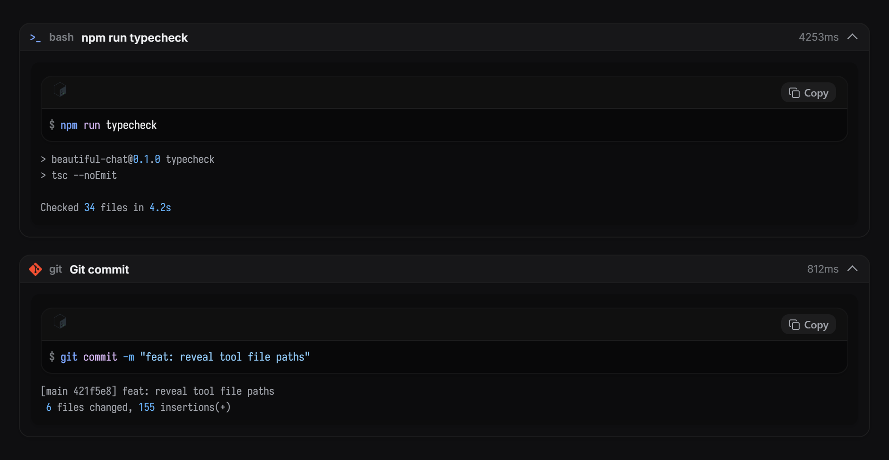

### Read

The file's own language logo, a wrapped path, line numbers, and a copy button. The path is a link:
pressing it shows the file in the machine's file manager.

Image and reveal paths keep spaces and punctuation in file names. Only a trailing selector, such
as `:55-85`, `:12:3`, or `#L10-L20`, is removed. On Windows, reveal paths use backslashes and
quotes so Explorer accepts spaces and commas.

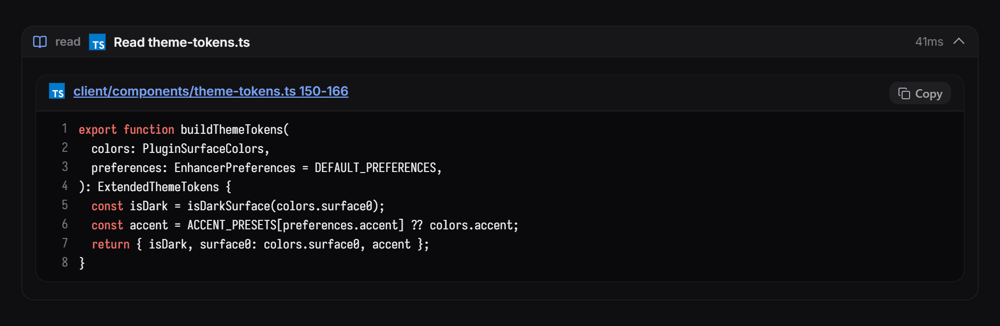

### Images

A read of a `.png` carries no bytes through the timeline, so the host draws it as an empty code
block with a language badge. This card draws the file instead: a picture mark, the path as a link,
the pixel size and file size read from the header, and an eye control that hides the thumbnail. The
bytes come from the plugin's own daemon-side RPC (`file.image`), which is the only side that can
reach the file; PNG, JPEG, GIF, WebP, AVIF, BMP, ICO and SVG are recognised, and anything past
3 MB reports its size rather than inlining a data URI.

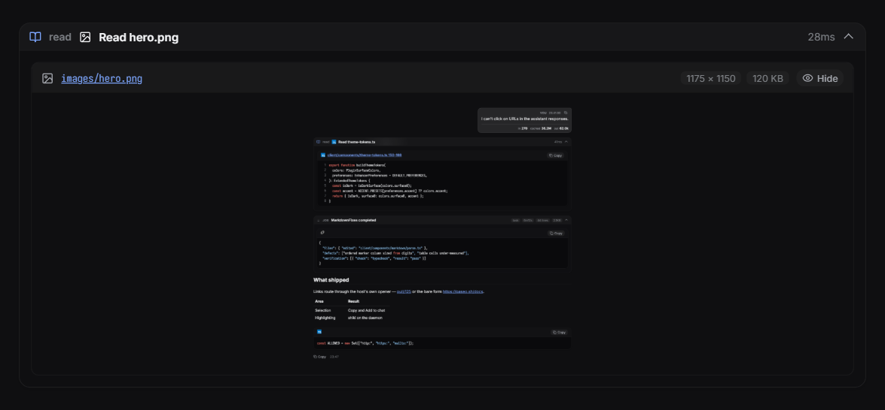

The same card draws a markdown image in a reply. The daemon appends `` after
any tool that returned a picture: a Claude Read of an image or a browser screenshot, a Codex
`view_image` or image generation, or an MCP tool result with an image block. Those go through the
same `file.image` RPC; an `http(s)` or `data:` source loads in the image view directly, and the
header shows the alt text, or the file name when the alt is just "Image".

### Edit

Diff rendering where adjacent removed and added rows join into one rounded block, and only the
marker column carries the red or green.

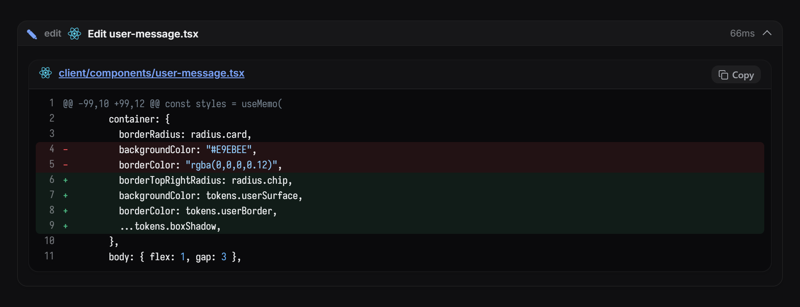

### Reasoning tool

Live thinking text, a token badge, and numbered steps.

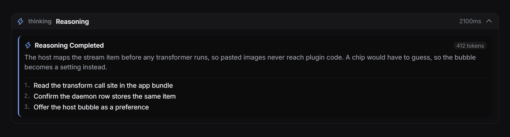

### MCP

Server badge, transport, input parameters, and the response payload, each syntax-highlighted.

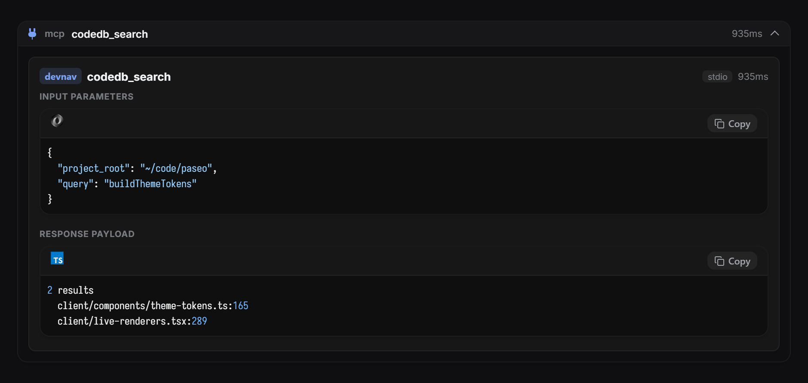

### Eval

One card per kernel cell: the source that ran, then the text it printed.

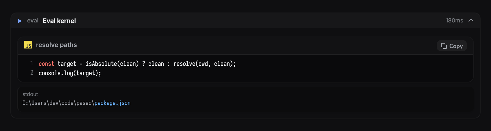

### Ask

Option cards with the recommended badge, the chosen answer marked, and a typed reply labelled as
typed rather than shown as a selection.

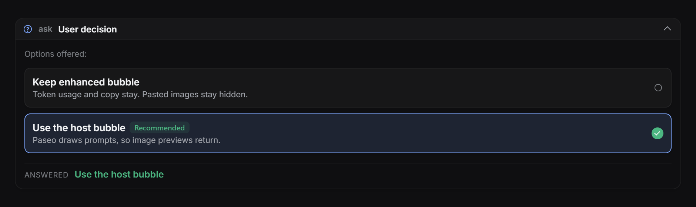

### Task

Subagent name, type, model, and the delegated instructions.

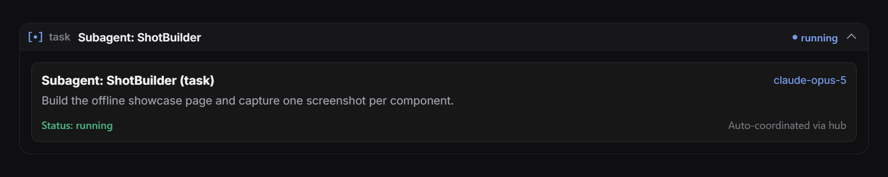

### Hub

Every `hub` op is mapped: `start`, `stop`, `restart`, `ps`, `logs`, and `describe` render the
process card with its launch line, readiness, and recent output; `send`, `wait`, `inbox`, and
`list` render the message card; `jobs` and `cancel` render the job snapshot. The cards report;
they carry no buttons, because a plugin cannot restart or cancel anything.

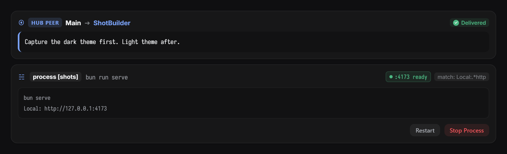

### Paseo tools

Paseo's own mark leads the card, and the created agent's provider carries its brand mark.

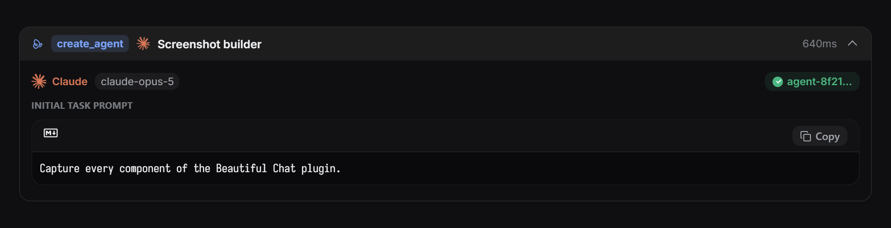

---

## Stream components

### Reasoning trace

A collapsible trace with a connected step rail, per-step duration, and a token total.

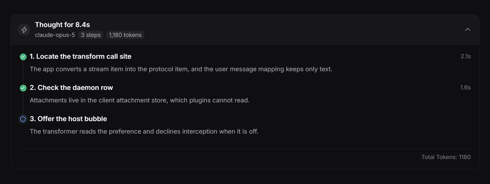

### Checklist

Phase name, per-task status, durations, and a blocked task with its reason.

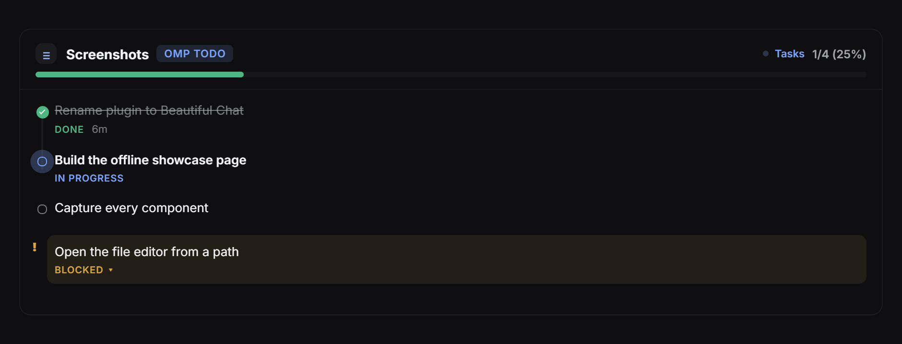

### Approval card

Risk classification, the exact command, target path, working directory, and the approve or deny
actions the host owns.

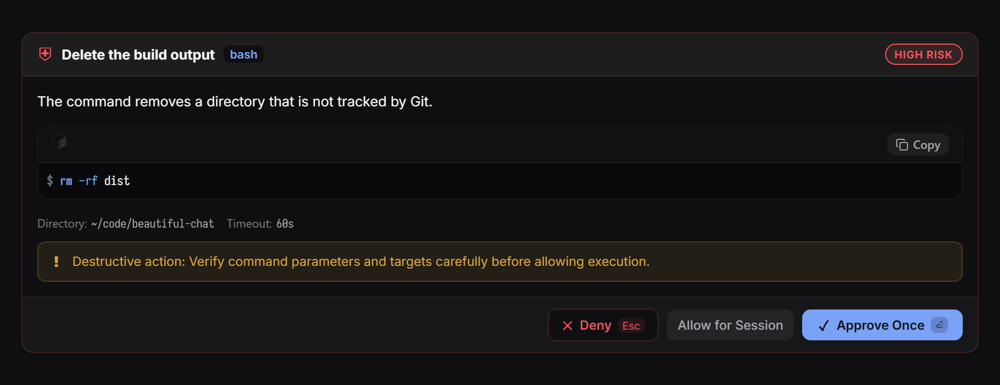

### Prompt bubble

The authored turn on a raised theme surface with a square tail, a copy button, and the turn's token
usage.


### Syntax block

Shared by every card that shows code: language detection from the path, line numbers, diff tints,
Devicon brand marks, and the file-manager link.

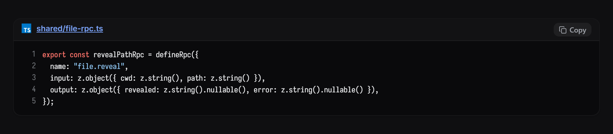

---

## Settings

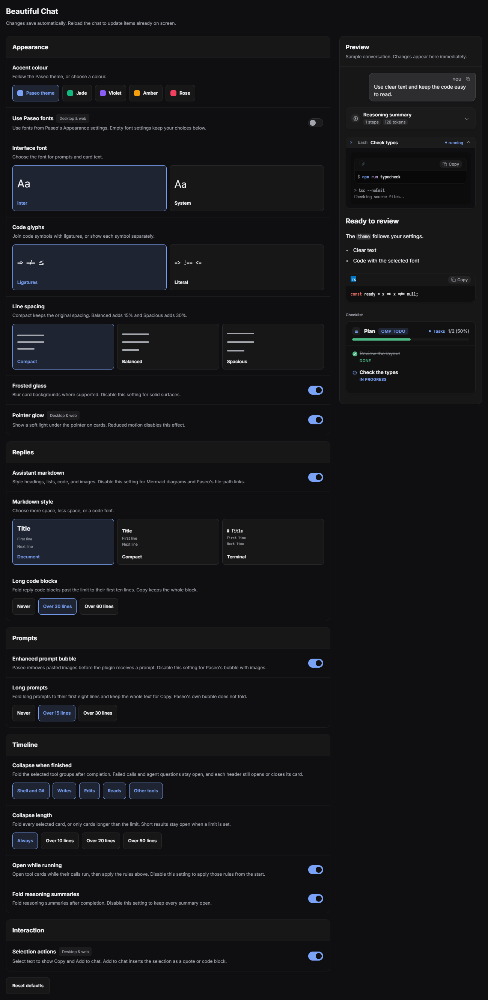

| Group | Setting | Effect |
| --- | --- | --- |
| Appearance | Accent colour | Follow the Paseo theme, or choose Jade, Violet, Amber, or Rose. |
| Appearance | Use Paseo fonts | Use Paseo's interface and code fonts on desktop and web. Empty font settings keep your plugin font choices. |
| Appearance | Interface font | Choose Inter or the system font. A font set in Paseo takes priority when Use Paseo fonts is on. |
| Appearance | Code glyphs | Use Iosevka with ligatures, or show each symbol separately. A code font set in Paseo takes priority when Use Paseo fonts is on. |
| Appearance | Line spacing | Keep the original spacing with Compact. Balanced adds 15% and Spacious adds 30%. |
| Appearance | Frosted glass | Blur card backgrounds where supported, or use solid surfaces. |
| Appearance | Pointer glow | Show a light under the pointer on cards on desktop and web. Reduced motion disables this effect. |
| Replies | Assistant markdown | Style headings, lists, code, and images, including local files through the daemon. Disable this setting for Mermaid diagrams and Paseo's file-path links. |
| Replies | Markdown style | Choose Document, Compact, or Terminal. This choice is disabled when Assistant markdown is off. |
| Replies | Long code blocks | Fold reply code blocks over 30 or 60 lines to a 10-line preview. Copy keeps the whole block. |
| Prompts | Enhanced prompt bubble | Show the plugin's prompt bubble without pasted images. Disable this setting for Paseo's bubble with images. |
| Prompts | Long prompts | Fold prompts over 15 or 30 lines to an 8-line preview. Paseo's own bubble does not fold. |
| Timeline | Collapse when finished | Choose shell, write, edit, read, and other tool groups independently. Failed calls and agent questions stay open. |
| Timeline | Collapse length | Fold every selected card, or only cards over 10, 20, or 50 lines. |
| Timeline | Open while running | Open tool cards while their calls run, then apply the collapse rules. Disable this setting to apply those rules from the start. |
| Timeline | Fold reasoning summaries | Fold summaries after completion. Disable this setting to keep every summary open. |
| Timeline | Let Paseo fold tool calls | Off by default. On desktop and web, let Paseo draw calls when its display setting folds them. |
| Timeline | Show reasoning between folded calls | On by default. Keep reasoning visible while Paseo folds tool calls. |
| Interaction | Selection actions | Select text to show Copy and Add to chat on desktop and web. Add to chat inserts a quote or code block. |
| Interaction | Ask before opening files | On by default. Ask before a safe file opens inside the working folder. Other files and paths always ask. |

The live preview uses the real prompt, reasoning, tool, reply, and checklist components with sample data.
It appears beside the settings at widths of 860 px or more, and above them on narrower screens.
On desktop and web, the page uses the scroll pane width, up to 1200 px, with a sticky preview column.

**Use Paseo fonts reads unsupported, private host state.** It reads `uiFontFamily` and `monoFontFamily`
from the `@paseo:app-settings` record in `localStorage`. The plugin SDK does not expose these settings
in 0.8 or 0.15. A host change can break this feature without warning. It has no effect on native,
which has no `localStorage`.

---

## Paseo tool-folding handoff

**Let Paseo fold tool calls** is off by default, so plugin tool cards stay unchanged.
On web and desktop, enable it with Paseo's **Collapse tool calls** or **Collapse turns** display setting.
Paseo then folds and draws tool calls instead of plugin cards.
A Paseo setting change reaches existing rows within about 2 seconds on an active client.
The plugin checks host settings only while **Let Paseo fold tool calls** is on.

Plugin-owned rows interrupt a fold of consecutive host tool calls.
**Show reasoning between folded calls** is on by default, so thoughts stay visible during handoff.
Turn it off to hide reasoning during handoff and let adjacent tool calls fold together.
This setting has no effect outside handoff.

Summary first shipped in [Paseo 0.1.108](https://github.com/getpaseo/paseo/pull/2031).
Since 0.13, Paseo uses `chatDisplay` for **Collapse tool calls** and **Collapse turns**.
The plugin reads the private `localStorage` key `@paseo:app-settings`.
The SDK exposes no host settings API in 0.8 or 0.15.
A host key or data shape change can silently stop handoff.
These settings have no effect on iOS or Android because those clients have no `localStorage`.

## Finding text

Paseo's own chat find (Ctrl/Cmd+F) cannot reach a prompt or reply this plugin draws (see
[limitation 14](#plugin-sdk-limitations-found-while-building-this)). The plugin therefore takes
Ctrl/Cmd+F on desktop and web and opens its own find bar over the chat. The bar searches
everything the chat has rendered, including tool cards. Enter moves to the next match, Shift+Enter
to the previous one, and Escape closes the bar.

The bar searches only messages the chat has loaded. Scroll up first to include older history.

To keep Paseo's native search, which also searches unloaded history, turn off **Assistant
markdown** and **Enhanced prompt bubble** in **Settings -> Plugins -> Beautiful Chat**. Paseo then
draws replies and prompts itself, and Ctrl/Cmd+F opens Paseo's find instead of the plugin's bar.
New messages follow the change.
Tool, reasoning, and checklist cards keep the plugin's styling, so Paseo's find still cannot reveal a
match inside one of them.

## Opening files

A file name in a read, write, edit, or code block is a link.
Press it to show the path in the file manager.
The path menu sends the agent ID and working folder when the renderer supplies them.
The daemon reads the agent's current working folder through the Paseo SDK.

| Platform | Show in File Manager                                  | Open in Default App          |
| -------- | ----------------------------------------------------- | ---------------------------- |
| Windows  | `explorer.exe /select,"<path>"` selects the path.     | `explorer.exe "<path>"`       |
| macOS    | `open -R <path>` selects the path in Finder.           | `open <path>`                |
| Other    | `xdg-open <directory>` opens the parent directory.     | `xdg-open <path>`            |

Reveal always selects the target on Windows and opens its parent directory on Linux, including directory targets.
All actions run on the computer that runs the Paseo daemon, not on the client.
macOS always reveals the path with `open -R`, including an app bundle.
**Show in File Manager** cannot launch that bundle and needs no confirmation.

On desktop and web, right-click a path link or inline code that contains an absolute path.
The menu offers **Copy Selection** when text is selected, **Copy Path**, **Open in Default App**, and **Show in File Manager**.
A relative path offers open and reveal actions only when the renderer supplies the agent's working folder.
A missing path or a launch error shows a message for five seconds.

**Open in Default App** first asks the daemon to inspect the path without a launch.
The daemon uses `realpath` and checks the resolved target, not a symlink name.
The dialog shows that target and says which computer opens it.
**Cancel** has focus. Press Escape or **Cancel** to cancel the launch.
Only **Open** in a dialog without a checkbox sends `confirmed: true`.
The ordinary dialog and the safe-file bypass send no confirmation flag.
The daemon repeats the policy check before each launch, including direct RPC calls.
An open uses the exact resolved path without another selector removal.
The daemon rejects a confirmed path if the final check resolves it to a different target.
On macOS, `open` and LaunchServices resolve the path again after that check.
A file or handler change in that interval can still change what opens.

Only these ASCII file extensions can open without the code warning. Letter case does not matter:

- Images: `png`, `jpg`, `jpeg`, `gif`, `webp`, `avif`, `bmp`, `ico`, `tif`, `tiff`, `heic`, `heif`.
- Text and data: `txt`, `text`, `md`, `markdown`, `rst`, `log`, `csv`, `tsv`, `json`, `jsonl`, `ndjson`, `yaml`, `yml`, `toml`, `ini`.
- Documents: `pdf`.
- Audio: `mp3`, `wav`, `ogg`, `oga`, `flac`, `aac`, `m4a`, `opus`, `aif`, `aiff`, `wma`.
- Video: `mp4`, `webm`, `mkv`, `mov`, `m4v`, `avi`, `mpg`, `mpeg`, `ogv`, `3gp`, `wmv`.

The client and daemon use the same allowlist in `shared/path-open-policy.ts`.
Every other extension, a path without an extension, and a directory require confirmation.
Any Unix executable permission bit requires confirmation, even when the file has an allowlisted extension.
The extension check keeps trailing dots and spaces and rejects non-ASCII extension characters.
On macOS, `com.apple.LaunchServices.OpenWith` and `com.apple.FinderInfo` attributes require confirmation.
FinderInfo can mark a Finder alias. The daemon treats every FinderInfo attribute as risky, even without the alias flag.
If the daemon cannot read the macOS attributes, it rejects the open.
A safe extension does not prove that file contents or the default app are safe.
Only open files that you trust.

A target outside the agent's resolved working folder always requires confirmation.
The dialog flags it as **outside the working folder** and has no **Don't ask again** checkbox.
Risky types also have no checkbox.
If the daemon cannot read the agent's working folder, every open requires confirmation.
The client-supplied folder can resolve a relative path but cannot bypass this rule.

For safe files inside the working folder, select **Don't ask again**, then press **Open**, to skip later questions.
Turn on **Ask before opening files** in the plugin settings to restore the question.
This setting defaults to on.
Path normalization keeps UNC and Windows namespace prefixes (`\\server\share`, `//server/share`, `\\.\`, `\\?\`, `//./`, and `//?/`).
An inspection of a UNC path can send network credentials before the confirmation dialog appears.

The macOS launcher reports a nonzero exit, a signal, or a three-second timeout as an error.
The Linux launcher reports an early failure but reports only `started` at three seconds because `xdg-open` can wait for its app.
Explorer can report a nonzero exit after success, so its RPC result reports only `started`, not completed.
Explorer spawn errors reach the client.
Actual macOS and Linux launchers remain untested.

Web links with `http`, `https`, or `mailto` use real anchors in replies.
The host can offer link-address actions. A normal press still uses Paseo's external opener.

## Unmapped output

A tool the plugin has no typed card for, such as `ToolSearch`, is drawn as a generic card. It shows
the call's input and its output as pretty JSON, or as plain text when the value is a string, and
long payloads are cut off at a sensible length. A call that returned nothing says "No output.".
Only a real shell call says "Command completed without output.". No card renders an empty panel.

The link cannot open Paseo's own file editor: see the first limitation below.

---

## Plugin SDK limitations found while building this

First measured against `@getpaseo/plugin` 0.8.0 and the Paseo 0.8.0 desktop build, and rechecked against the 0.15.0 types: limitations 1 to 3 still hold (0.15 adds a `navigation` prop to panels and screens, not to timeline renderers, and user messages still carry no attachment signal). Each entry names the
evidence and the workaround this plugin uses.

1. **No file navigation.** Timeline renderer props are exactly `{agentId, theme, host, layout,
timestamp, item}`, and plugin navigation offers only `openSettings`, `openSurface`,
   `openWorkspacePanel`, `openAgentPanel`, `openAgent`, and `openWorkspace`. The host's own file tab
   target (`{kind:"file", path}`, reachable in-app through `?open=file:<path>`) is not exposed, and
   the `paseo://` scheme only carries agent deep links. Workaround: a daemon-side RPC that reveals
   the path in the operating system's file manager.
2. **Transformers see a stripped item.** The app maps its stream item to the plugin item before any
   transformer runs, and a user message keeps only `text`, `messageId`, and `clientMessageId`. Pasted
   images never reach plugin code, and the daemon timeline row stores the same item, so a server RPC
   cannot recover them either. Workaround: the **Enhanced prompt bubble** setting returns prompts to
   the host.
3. **Interception is all or nothing.** A transformer replaces the host item completely. There is no
   way to decorate an item or keep host affordances that the plugin does not reimplement. Returning
   `undefined` is the only opt-out.
4. **Transform results are cached by transformer function and item.** A preference change alone does
   not re-run transformers for existing items. Workaround: the handoff re-registers the tool and
   reasoning transformers with fresh functions, so existing rows update without a reload.
5. **Renderers get no workspace.** Props carry `agentId` only, so `cwd` and `workspaceId` need a
   second lookup through `useAgent`.
6. **Token usage is live-only.** Usage is not persisted on timeline items, so a turn this client did
   not observe live shows no figures.
7. **RPC names are validated late.** The host requires `^[a-z][a-z0-9._-]*$`. A camelCase name such
   as `revealPath` typechecks, then fails the whole plugin at install or reload with
   `Invalid plugin RPC method`.
8. **The React Native runtime module is a stub in the package.** `@getpaseo/plugin/client/react-native`
   ships as `export {}`; the host injects the implementations. Bundling or testing plugin UI outside
   Paseo needs a shim, which is what `.showcase/shims` provides.
9. **The theme carries six colours.** `PluginTheme` exposes `surface0`–`surface2`, `border`,
   `foreground`, `foregroundMuted`, `accent`, `accentForeground`, and three status colours. Every
   other surface, including code backgrounds and diff tints, must be derived with alpha; that is what
   `client/components/theme-tokens.ts` exists for.
10. **No CSS escape hatch.** React Native styles drop unknown keys, so `backdrop-filter` is
    impossible through the style API. Frosted glass is a hand-injected `<style>` rule matched by a
    data attribute.
11. **No font registration.** Faces are embedded as data URIs in an injected `@font-face` rule, and
    every surface needs a wrapper that escapes the host's own font cascade.
12. **A closed module allowlist, and no SVG renderer.** Plugin client code may import only
    `react`, `react/jsx-runtime`, `react-native`, `@tanstack/react-query`, `zod`,
    `@getpaseo/plugin`, `@getpaseo/plugin/client`, `@getpaseo/plugin/client/react-native`, and
    `@getpaseo/plugin/client/ui`. Anything else throws
    `Module "x" is not available in plugin client code` when the bundle loads, so
    `react-native-svg` and `lucide-react-native` are out of reach. Lucide icons still work,
    because the host renders them: `Icon` from `@getpaseo/plugin/client/react-native` takes any
    Lucide name. Brand marks are not in Lucide, and React Native's `<Image>` decodes PNG, JPEG,
    GIF, and WebP but never SVG, so a data-URI SVG renders on web and stays blank on iOS and
    Android. Those marks ship as PNG rasters in `client/components/mark-bitmaps.ts`.
13. **Settings are host-scoped only.** `defineSettings` rejects any scope other than `host`, so
    per-workspace or per-agent presentation settings are impossible. This plugin keeps presentation
    preferences in client storage instead.
14. **Paseo's chat find cannot reach replaced rows.** Paseo 0.9.1 finds a match by its original
    message id, then waits for a row carrying that id. A transformed row always carries
    `<pluginId>/<itemId>` instead, so Ctrl+F on a styled prompt or reply never reveals the match.
    Workaround: the plugin's own find bar, described in [Finding text](#finding-text).

---

## Project structure

```text
beautiful-chat/
  paseo-plugin.json          # Manifest: id and Paseo requirement
  index.client.tsx           # Timeline transformers, renderers, settings screen
  index.server.ts            # Daemon-side RPCs (file.reveal)
  shared/
    contracts.ts             # Data contracts shared by client and server
    file-rpc.ts              # file.reveal contract
  client/
    live-renderers.tsx       # Timeline item to component mapping
    settings-page.tsx        # Settings screen
    preferences.ts           # Client-side presentation preferences
    components/              # Cards, syntax block, glyphs, motion, theme tokens
      mark-bitmaps.ts        # GENERATED PNG rasters of every brand mark
      devicon-data.ts        # Vendor SVG sources, read only by the generator
      lobe-marks.ts          # Vendor SVG sources, read only by the generator
  .showcase/                 # Offline harness used to capture the screenshots
  docs/images/               # Screenshots in this README
```

## Development

```bash
npm install
npm run typecheck
paseo plugin reload beautiful-chat
```

Rebuild the screenshots after a visual change:

```bash
esbuild .showcase/showcase.tsx --bundle --outfile=.showcase/showcase.js --jsx=automatic \
  --alias:react-native=react-native-web \
  --alias:@getpaseo/plugin/client=./.showcase/shims/plugin-client.tsx \
  --alias:@getpaseo/plugin/client/react-native=./.showcase/shims/plugin-react-native.tsx \
  --alias:@getpaseo/plugin/client/ui=./.showcase/shims/plugin-react-native.tsx
```

Then serve `.showcase/` and capture each `#shot-*` element.

## License

MIT
